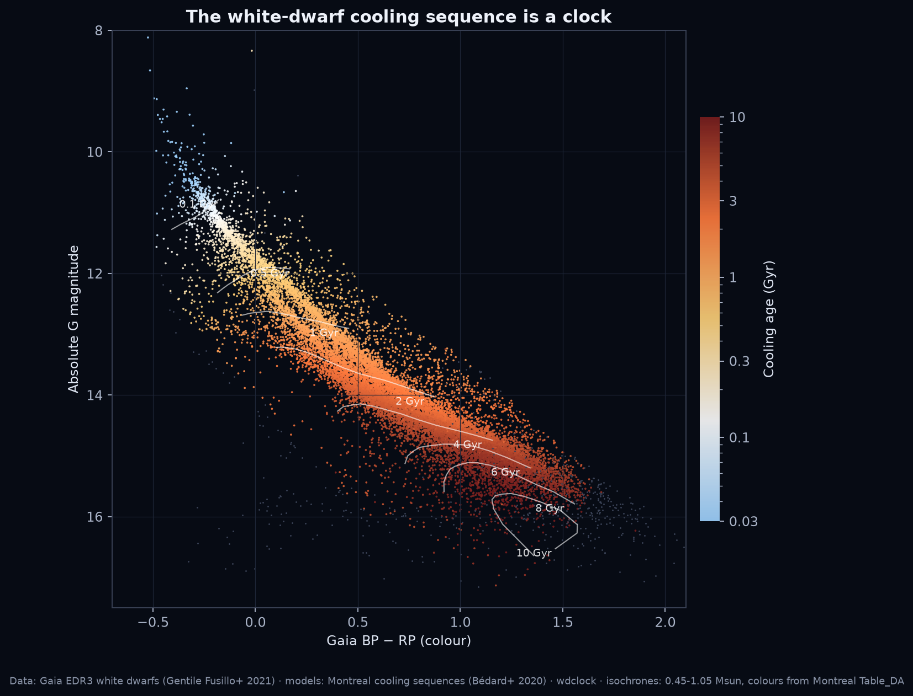
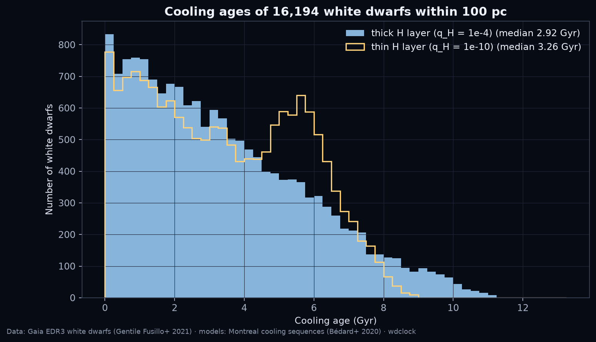
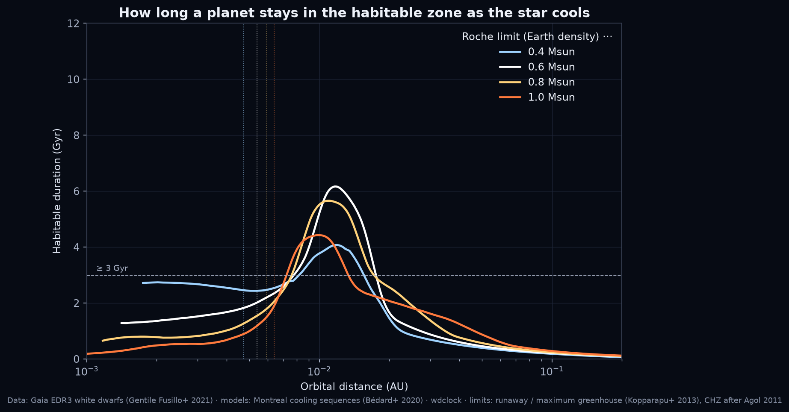
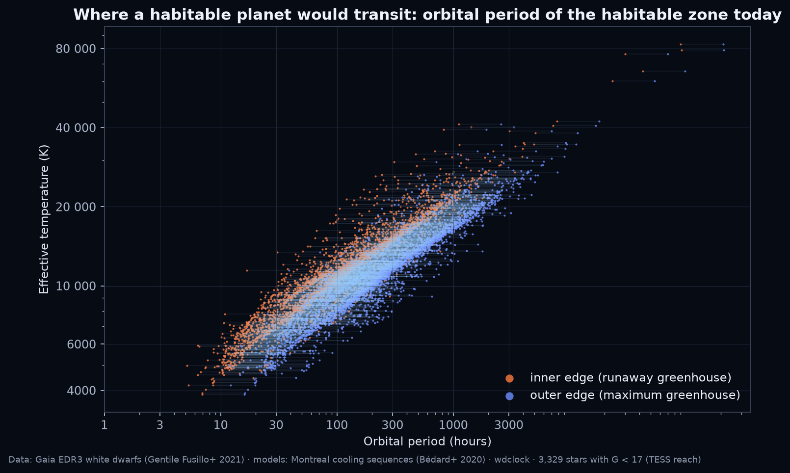
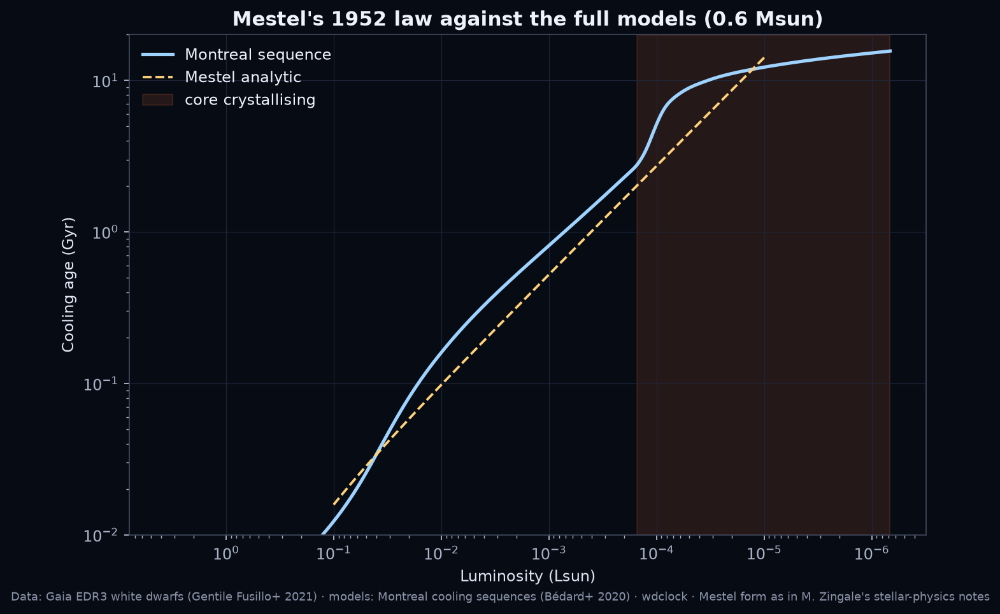

# wdclock

**White-dwarf cooling ages and habitable-zone windows from the Montreal evolutionary sequences.**

A white dwarf is a dead star that only cools. Its temperature and luminosity, read against a cooling model,
give the time since it formed: the best clock we have for old stars. `wdclock` reads that clock for one star
or for a whole catalogue, and asks the follow-up question that matters for planet hunters: where is the
habitable zone of that cooling star today, how fast would a planet there orbit, and for how long would it
stay habitable.

Built for the [Kister Space](https://www.youtube.com/@KisterSpace) search for planets around white dwarfs in
public TESS and Gaia data; the first public tool from that project.



## What it does

| function | physics | output |
|---|---|---|
| `CoolingGrid(layer).age(teff, mass)` | interpolates the Bédard et al. (2020) sequences (23 masses, thick `q_H = 1e-4` or thin `q_H = 1e-10` hydrogen layer) | cooling age [yr] |
| `.luminosity`, `.radius`, `.logg`, `.crystallised_fraction`, `.mass_from_logg` | same tracks | L [Lsun], R [Rsun], log g, crystallised core fraction, mass |
| `HabitableZone(grid).now(teff, mass)` | insolation limits of Kopparapu et al. (2013): runaway greenhouse (1.0512 S⊙) to maximum greenhouse (0.3438 S⊙), scaled with L | inner and outer edge [AU], orbital periods [d], Roche limit |
| `HabitableZone.duration_at(a, mass)` | the zone marches inward as the star cools; a planet at fixed `a` enters when L = S_in a² and leaves when L = S_out a² | entry and exit cooling ages, habitable duration |
| `HabitableZone.continuously_habitable(mass, t_min)` | Agol (2011) "continuously habitable zone" | range of `a` habitable for at least `t_min` |
| `mestel_age(L, mass)` | Mestel (1952) analytic law, in the form of M. Zingale's stellar-physics notes | the textbook estimate, for comparison |
| `catalog.run(df)` | all of the above on a table with `TeffH`, `MassH` (Gaia EDR3 catalogue columns) | ages, luminosities, HZ periods, transit probability and duration for an Earth in the zone |

```bash
pip install -e .                       # numpy, pandas; matplotlib for the figures
wdclock star --teff 25369 --mass 1.018 # Sirius B -> age_thick 0.127 Gyr (Bond et al. 2017: ~0.126)
wdclock chz --mass 0.6 --tmin 3        # Agol's CHZ: 0.0078-0.0174 AU, longest stay 6.2 Gyr at 0.0117 AU
wdclock catalog wd_100pc.csv wd_ages.csv
python examples/gaia_100pc.py wd_100pc.csv --lang en   # six figures
```

The Montreal tables (0.6 MB) are downloaded on first use into `~/.wdclock/montreal` (or `$WDCLOCK_MODELS`);
they are the work of Bergeron, Bédard and collaborators and are not redistributed here.

## Validation

| star | input (Teff, M) | source of input | wdclock cooling age | published |
|---|---|---|---|---|
| Sirius B | 25,369 K, 1.018 Msun | Bond et al. 2017 (HST astrometry + spectroscopy) | 127 Myr (thick), 140 (thin) | ~126 Myr (Bond et al. 2017) |
| 40 Eridani B | 17,200 K, 0.573 Msun | Mason et al. 2017 mass; Bond et al. 2017b Teff | 106 Myr (thick), 117 (thin) | ~122 Myr (Bond et al. 2017b, who favour a thin layer) |
| 40 Eridani B | 16,265 K, 0.568 Msun | Gaia EDR3 photometric fit (Gentile Fusillo et al. 2021) | 130 Myr (thick) | same |

Sirius B is a warning rather than a validation when its *Gaia* parameters are used: the EDR3 photometry of a
G = 8.5 star 10" from a G = −1.4 star is contaminated, the catalogue fit gives 10,900 K and 0.44 Msun, and the
clock then reads 0.34 Gyr instead of 0.13. Check the input before trusting the output.

`pytest` runs eight tests: the two calibrators, monotonicity, the log g inversion, grid limits, and Agol's CHZ
numbers (0.005–0.02 AU, maximum duration near 0.01 AU).

## Results on the Gaia 100 pc sample (16,676 white dwarfs, Gentile Fusillo et al. 2021)

Input: parallax > 10 mas, P_WD > 0.75, pure-hydrogen solution (`TeffH`, `MassH`). 16,194 stars fall inside the
model grid (0.20–1.30 Msun).

| quantity | value |
|---|---|
| median cooling age | 2.92 Gyr (thick), 3.26 Gyr (thin) |
| 16th–84th percentile | 0.84–6.04 Gyr |
| oldest stars | 11.1–11.3 Gyr (five stars at 62–83 pc, G ≈ 20.1–20.9, Teff ≈ 3900–4200 K) |
| hydrogen-layer systematic (median) | 0.09 Gyr |
| stars with more than half the core crystallised | 33.7 % |
| median within 40 pc (1,062 stars) | 2.78 Gyr |
| habitable-zone periods today, median (all) | 16 h (inner edge) to 38 h (outer edge) |
| habitable-zone periods, stars with G < 17 (TESS reach) | 100 h to 231 h: the TESS-bright stars are the young, hot ones |
| planet at the zone centre: median habitable duration | 2.75 Gyr |
| stars where that planet would stay habitable ≥ 3 Gyr | 7,686 (185 with G < 17) |
| geometric transit probability of such a planet, median | 0.56 % |
| transiting habitable Earths expected if every G < 17 star had one | 7.5 |

What the numbers mean: the age distribution is a cooling-age distribution of a magnitude-limited sample, not the
star-formation history of the disc. Old white dwarfs are faint (G > 20 at 70 pc) and Gaia loses them, and the
total age needs the progenitor lifetime (1–8 Gyr for the usual 1–3 Msun progenitors) added on top. With those
caveats, the oldest cooling ages of 11.1–11.3 Gyr agree with the 10.5–11.3 Gyr disc onset derived from white
dwarfs by Tremblay et al. (2014, 20 pc), Fantin et al. (2019, CFIS) and Cukanovaite et al. (2023, 40 pc).






## Limitations

- The clock is only as good as the input Teff and mass. Gaia photometric parameters are unreliable above
  40,000 K, below 0.2 and above 1.3 Msun, for unresolved binaries, for contaminated photometry (Sirius B), and
  the pure-hydrogen solution is wrong for helium-atmosphere stars (about 20–25 % of the sample).
- Thick versus thin hydrogen layers change the age by a few per cent for most stars, more for old ones; the
  real distribution of layer masses is not known star by star.
- Habitable-zone limits are the Solar-System-calibrated Kopparapu et al. (2013) fluxes without their
  temperature correction, which is only valid for 2600–7200 K stars. UV photolysis of water by a young white
  dwarf (Barnes & Heller 2013; Kozakis, Kaltenegger & Hoard 2018), tidal locking and the need for the planet to
  arrive at 0.01 AU after the giant phases are not modelled: the zone is necessary, not sufficient.
- The 100 pc sample is not volume-complete for cool white dwarfs; the age distribution is descriptive.

## References

- Bédard, A., Bergeron, P., Brassard, P., Fontaine, G. 2020, ApJ 901, 93 (cooling sequences; Montreal web site
  https://www.astro.umontreal.ca/~bergeron/CoolingModels/)
- Gentile Fusillo, N. P. et al. 2021, MNRAS 508, 3877 (Gaia EDR3 white dwarf catalogue, VizieR J/MNRAS/508/3877)
- Agol, E. 2011, ApJL 731, L31 (white-dwarf habitable zone, CHZ, Roche limit)
- Kopparapu, R. K. et al. 2013, ApJ 765, 131 (habitable-zone insolation limits)
- Barnes, R., Heller, R. 2013, Astrobiology 13, 279 (perils of a cooling primary)
- Kozakis, T., Kaltenegger, L., Hoard, D. W. 2018, ApJ 862, 69 (UV environment of planets around white dwarfs)
- Mestel, L. 1952, MNRAS 112, 583 (analytic cooling law); form from M. Zingale, stellar-physics notes
  (https://zingale.github.io/stars/)
- Bond, H. E. et al. 2017, ApJ 840, 70 (Sirius B); Bond, H. E. et al. 2017b, ApJ 848, 16 (40 Eri B); Mason, B. D.
  et al. 2017, AJ 154, 200 (40 Eri BC orbit)
- Tremblay, P.-E. et al. 2014, ApJ 791, 92; Fantin, N. J. et al. 2019, ApJ 887, 148; Cukanovaite, E. et al. 2023,
  MNRAS 522, 1643 (local star-formation history from white dwarfs)

Please acknowledge the Montreal web site and cite Bédard et al. (2020) if you use the ages.

## Video

"Dead stars are clocks" (6 min, Kister Space, scheduled for 12 November 2026): https://youtu.be/Holnz6odRoQ — the figures and animations in it were made with this package (`examples/gaia_100pc.py` and the project's `skyimages/wdclock_anim.py`).

## Status

v0.1.0, 2026-11-09. Written by Christian Jair (Kister Space).
See `LEARNING.md` for what we learned building it. Issues and pull requests welcome.
